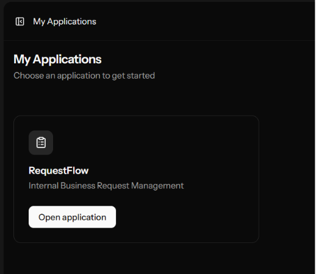
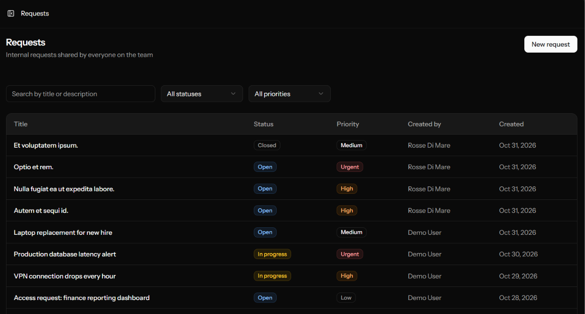
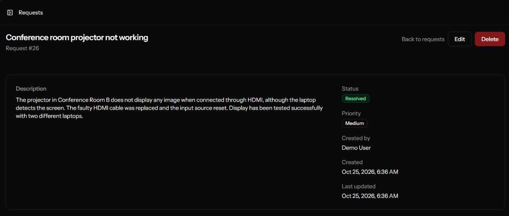

# RequestFlow

RequestFlow is an internal business request management application. Authenticated users can submit, track and update service requests, and a central "My Applications" dashboard acts as the entry point to the available applications.

It is built with Laravel and React, connected through Inertia.js, and covered by an automated test suite and a CI pipeline.

## Features

- **Request management**: create, view, edit and delete service requests with a title, description, status, priority and timestamps.
- **Status and priority workflow**: four statuses (open, in progress, resolved, closed) and four priorities (low, medium, high, urgent). New requests always start as open.
- **Search and filtering**: search by text in the title and description, filter by status and priority, and browse results with pagination (15 per page).
- **Server-side validation**: input is validated with Laravel Form Requests, with shared rules for creating and updating requests.
- **Authorization**: access goes through a policy. Every authenticated user can view all requests and create new ones, but only a request's creator can edit or delete it. The Edit and Delete buttons are shown only to the creator, and the server enforces the rule regardless of the UI.
- **Creator tracking**: each request records the user who created it.
- **Application launcher**: the dashboard ("My Applications") lists the available applications from a typed registry, which currently contains RequestFlow.
- **Authentication**: login, registration and password reset through Laravel Fortify.
- **User settings**: profile, security (password) and appearance pages.
- **Quality tooling**: Pest tests, static analysis with PHPStan (Larastan, level 7), code style with Pint, frontend linting and type checking, and a GitHub Actions workflow that runs them all.

## Tech stack

| Layer               | Technology                                                              |
| ------------------- | ----------------------------------------------------------------------- |
| Backend             | PHP 8.3+, Laravel 13, Laravel Fortify                                   |
| Frontend            | React 19, TypeScript, Inertia.js 3, Tailwind CSS 4, Radix UI components |
| Routing bridge      | Laravel Wayfinder (generated, typed route helpers)                      |
| Build tooling       | Vite+                                                                   |
| Database            | SQLite                                                                  |
| Testing and quality | Pest, PHPStan (Larastan), Pint                                          |
| CI                  | GitHub Actions                                                          |

## Screenshots

### My Applications



### Requests



### Request Details



## Prerequisites

- PHP 8.3 or later with the `pdo_sqlite` extension
- [Composer](https://getcomposer.org/) 2
- Node.js 22 or later and npm

The CI pipeline runs on PHP 8.5 and Node.js 22.

## Installation

```bash
git clone https://github.com/rossedimare/RequestFlow
cd RequestFlow
composer setup
```

`composer setup` installs the PHP dependencies, creates `.env` from `.env.example`, generates the application key, runs the database migrations, installs the npm dependencies and builds the frontend assets.

The application uses SQLite, so no database server is needed.

## Running the application

```bash
composer dev
```

This starts the PHP development server and the Vite dev server together. Open <http://localhost:8000> in your browser.

To create the first user, go to `/register` and sign up. After signing in you land on the "My Applications" dashboard, where the RequestFlow card opens the requests list.

> **Note:** in local development the mail driver is set to `log`, so emails such as password reset links are written to `storage/logs/laravel.log` instead of being sent.

## Tests and quality checks

```bash
composer test         # Pint (check only), PHPStan, then the Pest test suite
php artisan test      # Pest test suite only
npm run check         # frontend lint and format check
npm run types:check   # TypeScript type check
composer ci:check     # the full set of checks that CI runs
```

To fix code style automatically:

```bash
composer lint         # PHP (Pint)
npm run check:fix     # frontend
```

Tests run against an in-memory SQLite database and do not touch your local data.

## Project status

RequestFlow is a working application. Authenticated users can sign up, sign in, manage service requests (create, view, edit, delete, search and filter), manage their account settings and reach everything from the "My Applications" dashboard. The test suite and static analysis run on every push to `main` and on pull requests.

## License

This project is licensed under the [MIT License](LICENSE).
